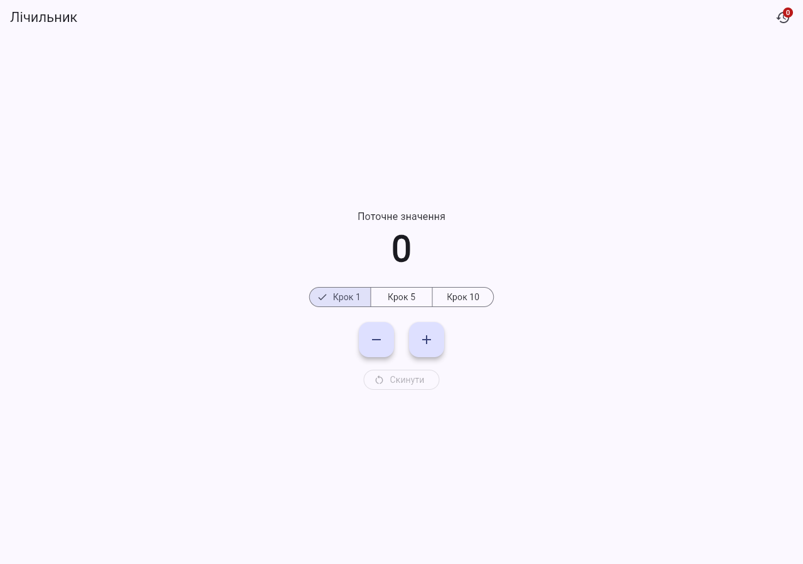
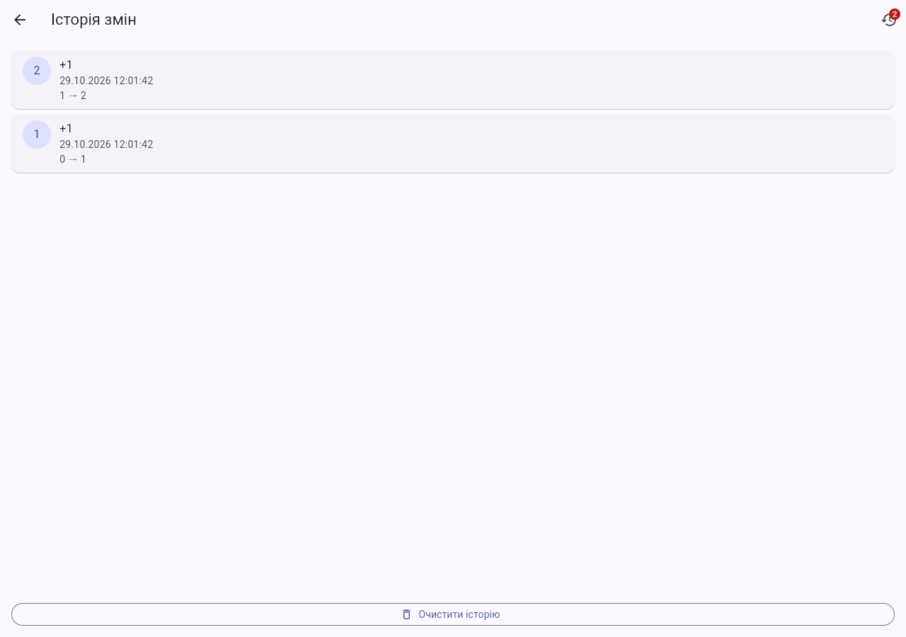

# Практична робота 6.1 — базовий State Management у Flutter

**Варіант 1: Лічильник з історією**

## Функціональність

Екран лічильника з кнопками `+`, `−`, `Скинути` та вибором кроку `1 / 5 / 10`. Кожна зміна записується в історію (час, дія, значення до/після). Екран історії показує записи від новіших до старіших, кнопка `Очистити історію` їх видаляє. В AppBar обох екранів — бейдж з кількістю записів. Значення не може бути від’ємним: при спробі відняти більше, ніж є, показується пояснення в SnackBar.

## Запуск

Потрібен Flutter stable. Якщо в репозиторії немає каталогів `android/` та `ios/`, один раз згенеруйте їх (код у `lib/` не змінюється):

```bash
flutter create --platforms=android,ios,web .
```

Далі:

```bash
flutter pub get
flutter analyze
flutter test
flutter run
```

Сторонні state-management пакети не використовуються: лише Flutter SDK та `flutter_lints`.

## Етапи Git

| Тег | Що зроблено |
|---|---|
| `stage-1-lifting` | Значення й історія піднято в `_CounterAppState` (спільний предок). Дані йдуть вниз конструкторами, зміни — вгору колбеками (`onIncrement`, `onDecrement`, `onReset`, `onClear`) через `setState`. Екран історії перемикається в предку (а не через `Navigator.push`), бо маршрут, відкритий через `push`, зберігав би застарілі дані. |
| `stage-2-inherited` | Стан винесено в `CounterState extends ChangeNotifier`, який надається через `CounterScope extends InheritedNotifier<CounterState>` зі статичним `CounterScope.of(context)`. Проміжні віджети більше нічого не передають; екран історії відкривається звичайним `Navigator.push`. |

Переглянути етап: `git checkout stage-1-lifting` / `git checkout stage-2-inherited`.

## Таблиця стану

| Дані | Тип стану | Де живуть | Чому саме там |
|---|---|---|---|
| Поточне значення | стан застосунку | `CounterState._value` (етап 1: `_CounterAppState._value`) | Потрібне екрану лічильника й записам історії |
| Історія змін | стан застосунку | `CounterState._history` (етап 1: `_CounterAppState._history`) | Потрібна екрану історії та бейджу на обох екранах |
| Обраний крок | ефемерний | `_CounterPanelState._step` | Стосується лише форми керування на екрані лічильника |
| Відкрита сторінка | ефемерний (навігація) | `Navigator` (етап 1: прапорець `_historyOpen`) | Не є даними домену |
| Час, дія, до/після | незмінний запис | `HistoryEntry` (`const`-конструктор) | Запис не змінюється після створення |

## Журнал перебудов (етап 2)

У `build()` ключових віджетів є `debugPrint('build: <Віджет>')`. Дія: запустити `flutter run`, один раз натиснути `+` на екрані лічильника, скопіювати з консолі нові рядки.

Очікування за кодом: перебудовуються лише `CounterPanel` і `HistoryBadge` (вони читають `CounterScope.of(context)`), а `CounterScreen` — ні.

```text
ВСТАВТЕ СЮДИ СВІЙ РЕАЛЬНИЙ ВИВІД КОНСОЛІ ПІСЛЯ НАТИСКАННЯ «+»
```

Для порівняння, на етапі 1 (`git checkout stage-1-lifting`) після `+` перебудовується весь екран: `CounterApp`, `CounterScreen`, `CounterPanel`, `HistoryBadge`.

```text
ВСТАВТЕ СЮДИ ВИВІД ЕТАПУ 1 (за бажанням)
```

## Скриншоти основних екранів





## Структура

```text
lib/
├── main.dart
├── models/history_entry.dart
├── state/counter_state.dart
├── state/counter_scope.dart
├── screens/counter_screen.dart
├── screens/history_screen.dart
└── widgets/
    ├── counter_panel.dart
    └── history_badge.dart
test/
├── counter_state_test.dart
└── widget_test.dart
```

## Декларація використання ШІ

> Заповніть цей розділ самостійно й чесно. Вимога курсу: назва інструмента ШІ; мета використання; текстовий запит (промпт); які фрагменти увійшли до роботи; що ви перевірили й змінили самі. Якщо ШІ не використовувався — напишіть одним реченням, що не використовувався.

- Інструмент:
- Мета використання:
- Промпт:
- Які фрагменти увійшли до роботи:
- Власне доопрацювання та перевірка:
